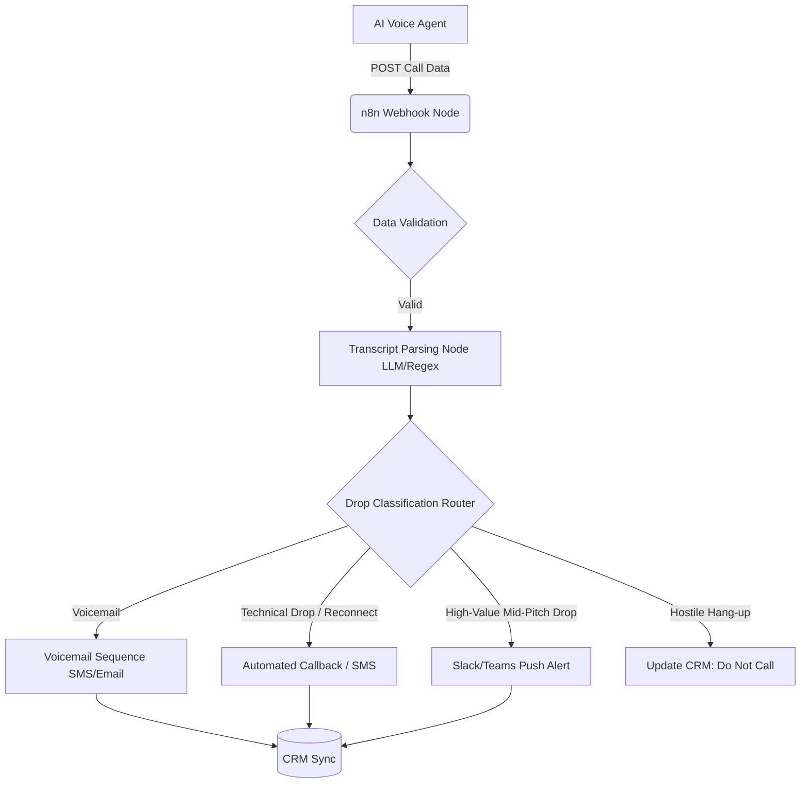

# AI Voice Agent Call Drop Recovery & Alert Pipeline — n8n Engine


> **Instantly ingest, categorize, and recover dropped AI voice calls with this self-hosted n8n pipeline.**

---

## ⚡ Instant Download & Turnkey Blueprint

- 📦 **Complete Production Package (€17 (Use code `EARLYBIRD` for -20%)):** 👉 **[Download on Gumroad](https://mannyverse767.gumroad.com/l/pnrddv)**
- 🎁 **Free Starter Blueprints (0€):**
  - [Autonomous AI Memory & Notion/Airtable RAG Sync (n8n Engine)](https://mannyverse767.gumroad.com/l/ai-agent-memory-rag-sync-notion-airtable-n8n-20260929)
  - [Programmatic SEO Markdown Engine with Quality Gates (Python)](https://mannyverse767.gumroad.com/l/programmatic-seo-markdown-generator-python-20260929)
- 💎 **MR Studio All-Access Lifetime Vault (€39 One-Time):** **[Unlock All Current + Future Workflows & Engines](https://mannyverse767.gumroad.com/l/depoud)**

---

## 🎯 The Problem & Financial ROI

When an AI voice assistant encounters a dropped connection, voicemail, or sudden user hang-up, the lead is often permanently lost. Relying on manual campaign dashboard reviews means recovery attempts happen too late, destroying conversion rates and wasting outbound budget.

| Metric | ❌ Traditional Cloud SaaS | ✅ MR Studio Self-Hosted Blueprint |
| :--- | :--- | :--- |
| **Annual Cost** | $600 – $2,400 / year | **€17 One-Time** |
| **Data Privacy & IP** | Third-party cloud lock-in | **100% Self-Hosted on your own infra** |
| **Execution Limits** | Strict per-task / per-seat quotas | **Unlimited runs & full source ownership** |
| **Stack** | Closed black-box | **n8n JSON Workflow** |

---

## 🛠️ Key Capabilities Included in the Package

- ✅ **Real-time webhook ingestion of call-end event data**
- ✅ **Contextual transcript parsing to categorize call failure reasons**
- ✅ **Automated multi-channel recovery sequencing**
- ✅ **Instant push alerts to human sales teams for high-value leads**


---

## 📖 Technical Documentation & Setup Guide

# AI Voice Agent Call Drop Recovery & Alert Pipeline — n8n Engine

[](#)
[](#)
[](#)

A high-throughput, low-latency n8n workflow designed to instantly salvage leads from failed AI voice agent interactions. 

**The Problem:** When an AI voice assistant encounters a dropped connection, an answering machine, or a sudden user hang-up, the lead is typically lost permanently. Relying on manual campaign dashboard reviews guarantees that recovery attempts happen too late, destroying conversion rates and wasting outbound budget. 

**The Solution:** This pipeline ingests call-end webhooks in real-time, parses the call transcript to determine the exact point and reason of failure, and dynamically routes the lead to automated multi-channel recovery sequences or escalates to human sales teams.

---

## 1. Overview & Architecture

This pipeline is delivered as a native n8n workflow (`workflow_n8n.json`) optimized for immediate deployment. 

### Core Features
*   **Real-time Webhook Ingestion:** Catch POST requests containing call-end event data (metadata, duration, endpoint status) with zero polling latency.
*   **Contextual Transcript Parsing:** Utilizes LLM integration (or Regex pattern matching) to analyze partial transcripts and categorize the drop reason (e.g., *Voicemail*, *Hostile Hang-up*, *Technical Drop*, *Mid-Pitch Drop*).
*   **Automated Multi-Channel Recovery Sequencing:** Triggers contextual SMS or Email follow-ups based on the drop reason (e.g., "Looks like we got disconnected, are you still there?").
*   **Instant Push Alerts:** Routes high-value leads (determined by CRM data or mid-pitch drop context) directly to human sales teams via Slack/Microsoft Teams/Discord for immediate manual dialing.

### Architecture Flow



---

## 2. Prerequisites & Environment Setup

To deploy this pipeline, ensure your infrastructure meets the following requirements:

*   **n8n Instance:** v1.0.0 or higher. Self-hosted (Docker/k8s) or n8n Cloud.
*   **Inbound Network:** n8n Webhook URLs must be publicly exposed and whitelisted on your AI Voice Agent platform (e.g., Vapi, Bland AI, Retell).
*   **Provider Credentials:**
    *   *LLM Provider:* OpenAI, Anthropic, or local LLM API keys for transcript parsing.
    *   *Comms Providers:* Twilio/MessageBird (SMS), SendGrid/AWS SES (Email).
    *   *Alerting:* Slack Webhook URL or Microsoft Teams Webhook.
    *   *CRM:* API Keys for HubSpot, Salesforce, or GoHighLevel.

---

## 3. Installation & Quickstart

Follow these steps to deploy the `workflow_n8n.json` file into your environment.

**Step 1: Import the Workflow**
1. Navigate to your n8n workspace.
2. Click **Add Workflow** -> **Import from File**.
3. Select `workflow_n8n.json` from this repository.

**Step 2: Configure Credentials**
1. Double-click the nodes marked with an orange warning icon.
2. Create or select existing credentials for your LLM, Email, SMS, and Alerting nodes.

**Step 3: Establish Webhook Endpoint**
1. Open the initial **Webhook** node.
2. Select **Production URL**.
3. Copy the URL and configure your AI Voice Agent's dashboard to push "Call Ended" events to this endpoint.

**Step 4: Activate**
1. Toggle the workflow to **Active** in the top-right corner of the n8n UI.
2. Trigger a test call on your voice agent and hang up prematurely to verify ingestion and routing.

---

## 4. Configuration Options

While standard n8n workflows manage state internally, this pipeline relies on environment variables for global thresholds and API configuration. 

Define these in your n8n `.env` file or via n8n Environment Variables if using n8n Cloud.

```env
# ==========================================
# CALL DROP RECOVERY PIPELINE CONFIG
# ==========================================

# Alerting Thresholds
# Minimum duration (seconds) before a drop is considered a "high-value" partial pitch
MIN_PITCH_DURATION_SEC=45 
# Lead scoring threshold for human escalation
HIGH_VALUE_LEAD_SCORE=80  

# LLM Parsing Configuration
TRANSCRIPT_PARSER_MODEL="gpt-4o-mini" # Fast, low-cost model recommended for JSON extraction
TRANSCRIPT_PARSER_TEMP=0.1            # Keep strictly deterministic

# Communication Delays (n8n Wait Nodes)
RECOVERY_SMS_DELAY_MINUTES=2
RECOVERY_EMAIL_DELAY_MINUTES=15
```

### Adjusting Workflow Variables
Within the n8n UI, navigate to **Variables** (or customize the internal `Set` node) to adjust messaging templates dynamically based on your campaign parameters.

---

## 5. Production Tips & Maintenance

To maintain high deliverability and system stability at scale, adhere to the following operational guidelines:

*   **Concurrency & Queueing:** If you are processing thousands of calls per hour, ensure your n8n instance is running in `queue` mode with Redis and separate Worker instances. Synchronous webhook processing will drop payloads under heavy concurrent load.
*   **Idempotency Handling:** The workflow includes a deduplication check. Ensure the `Call_ID` mapped from the webhook payload is written to Redis or the CRM to prevent sending duplicate recovery SMS messages if the voice platform fires duplicate webhooks.
*   **Execution Data Pruning:** Transcript parsing generates large execution logs. Configure your n8n `.env` to prune execution data aggressively to prevent database bloat:
    ```env
    EXECUTIONS_DATA_PRUNE=true
    EXECUTIONS_DATA_MAX_AGE=168 # 7 Days
    ```
*   **LLM Rate Limiting:** Transcript parsing nodes can hit API rate limits during massive call batch failures. Utilize n8n's built-in "Batching" or implement exponential backoff settings on the HTTP/OpenAI nodes.

---

## 6. License & Support Info

**License:** MIT License. Free for commercial and private use.

**Support:**
*   For issues specifically related to n8n node failures, consult the [n8n Community Forums](https://community.n8n.io/).
*   For bugs within the parsing logic or routing architecture, please open an Issue in this repository providing:
    1. A sanitized JSON payload of the webhook.
    2. The expected routing outcome.
    3. The actual routing outcome.

*Contributions and Pull Requests optimizing the LLM extraction prompt are welcome.*

---

## 🚀 Ready to Deploy in Under 5 Minutes?

Skip days of trial-and-error debugging. Grab the verified, production-tested package (including full source/JSON, `.env.example`, and automated test suite):

👉 **[Get AI Voice Agent Call Drop Recovery & Alert Pipeline — n8n Engine on Gumroad](https://mannyverse767.gumroad.com/l/pnrddv)** *(Promo code: `EARLYBIRD` for -20%)*
