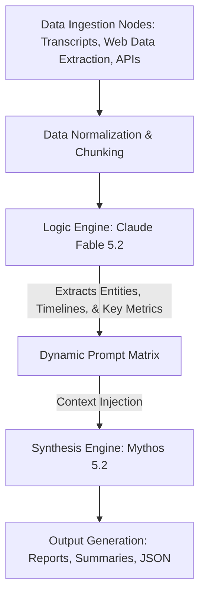

# Autonomous Context & Narrative Synthesis — n8n Workflow


> **A self-hosted n8n pipeline combining Claude Fable and Mythos 5.2 for enterprise-grade narrative synthesis and reasoning.**

---

## ⚡ Instant Download & Turnkey Blueprint

- 📦 **Complete Production Package (€19 (Use code `EARLYBIRD` for -20%)):** 👉 **[Download on Gumroad](https://mannyverse767.gumroad.com/l/czjaxk)**
- 🎁 **Free Starter Blueprints (0€):**
  - [Autonomous AI Memory & Notion/Airtable RAG Sync (n8n Engine)](https://mannyverse767.gumroad.com/l/ai-agent-memory-rag-sync-notion-airtable-n8n-20260929)
  - [Programmatic SEO Markdown Engine with Quality Gates (Python)](https://mannyverse767.gumroad.com/l/programmatic-seo-markdown-generator-python-20260929)
- 💎 **MR Studio All-Access Lifetime Vault (€39 One-Time):** **[Unlock All Current + Future Workflows & Engines](https://mannyverse767.gumroad.com/l/depoud)**

---

## 🎯 The Problem & Financial ROI

Transforming massive volumes of unstructured data into cohesive, strategic narratives traditionally requires expensive human analysts or costly enterprise AI subscriptions. Relying on managed platforms restricts your custom prompt architecture and artificially limits your data throughput.

| Metric | ❌ Traditional Cloud SaaS | ✅ MR Studio Self-Hosted Blueprint |
| :--- | :--- | :--- |
| **Annual Cost** | $600 – $2,400 / year | **€19 One-Time** |
| **Data Privacy & IP** | Third-party cloud lock-in | **100% Self-Hosted on your own infra** |
| **Execution Limits** | Strict per-task / per-seat quotas | **Unlimited runs & full source ownership** |
| **Stack** | Closed black-box | **n8n JSON Workflow** |

---

## 🛠️ Key Capabilities Included in the Package

- ✅ **Dual-model pipeline optimized for Claude Fable 5.2 (Logic) and Mythos 5.2 (Synthesis)**
- ✅ **Automated data ingestion nodes for transcripts, market research, and raw text**
- ✅ **Dynamic prompt matrices for adaptive context injection and formatting**
- ✅ **100% self-hosted architecture ensuring complete data privacy and zero recurring platform fees**


---

## 📖 Technical Documentation & Setup Guide

# Autonomous Context & Narrative Synthesis — n8n Workflow

Transforming massive volumes of unstructured data into cohesive, strategic narratives traditionally requires expensive human analysts or costly enterprise AI subscriptions. Relying on managed SaaS platforms restricts custom prompt architecture, artificially limits data throughput, and introduces data privacy vulnerabilities.

This repository provides a production-ready **n8n workflow** (`workflow_n8n.json`) designed to ingest, process, and synthesize large-scale unstructured data streams into strategic narratives using a 100% self-hosted, dual-model pipeline.

---

## 1. Overview & Architecture

The **Autonomous Context & Narrative Synthesis** workflow operates as a multi-stage, directed acyclic graph (DAG) within n8n. It leverages a specialized dual-model approach, separating logical data structuring from creative narrative synthesis, ensuring high-fidelity outputs without context degradation.

### Key Features
* **Dual-Model Pipeline**: Architected and optimized for **Claude Fable 5.2** (Logic, Extraction, and Structuring) and **Mythos 5.2** (Narrative Synthesis and Tone Formatting).
* **Automated Data Ingestion Nodes**: Pre-configured webhooks and polling nodes for ingesting raw text, transcription files, and market research feeds.
* **Dynamic Prompt Matrices**: Employs adaptive context injection, dynamically adjusting system prompts and few-shot examples based on the payload's metadata and token density.
* **100% Self-Hosted Architecture**: Guarantees complete data sovereignty, zero recurring platform fees, and unrestricted throughput.

### Pipeline Topology



---

## 2. Prerequisites & Environment Setup

Ensure your infrastructure meets the following minimum requirements before deploying the workflow.

* **Compute / Host**: Minimum 4 vCPUs, 16GB RAM (Recommended: 8 vCPUs, 32GB RAM for high-throughput chunking).
* **n8n Instance**: Self-hosted n8n (v1.0.0 or higher) running via Docker, npm, or PM2.
* **Model Inference Infrastructure**: 
  * Self-hosted inference server (e.g., vLLM, Ollama, or LocalAI) serving the *Fable 5.2* and *Mythos 5.2* models.
  * *Alternatively*: API access to an Anthropic/OpenAI-compatible gateway routing to these specific model endpoints.
* **Database**: PostgreSQL (Recommended over SQLite for production-level execution logs and persistent storage).

---

## 3. Installation & Quickstart

Follow these steps to deploy the workflow into your n8n environment.

### Step 1: Acquire the Workflow File
Download the core deliverable from the repository:
```bash
wget https://raw.githubusercontent.com/your-org/repo/main/workflow_n8n.json
```

### Step 2: Import into n8n
1. Navigate to your n8n UI (e.g., `http://localhost:5678`).
2. Go to the **Workflows** dashboard.
3. Click **Add Workflow** -> **Import from File**.
4. Select the downloaded `workflow_n8n.json` file.
5. The pipeline graph will populate on the canvas.

### Step 3: Configure Credentials
The workflow utilizes HTTP Request nodes and native LLM chain nodes requiring authentication to your inference server.
1. Open the **Credentials** tab in n8n.
2. Create a new **Custom API** credential or **OpenAI-Compatible API** credential (depending on your inference server wrapper).
3. Bind the newly created credentials to the *Fable 5.2* and *Mythos 5.2* execution nodes.

### Step 4: Activate and Execute
1. Review the input nodes (Webhook/File triggers). Set your required authentication (Basic Auth/Header Auth) for the webhooks.
2. Toggle the workflow to **Active** in the top-right corner.
3. Trigger a test payload via cURL:
```bash
curl -X POST http://<n8n-domain>/webhook/ingest-context \
     -H "Content-Type: application/json" \
     -d '{"source": "market_research", "content": "Raw unstructured text goes here..."}'
```

---

## 4. Configuration Options

To support the dynamic prompt matrices and high-volume data ingestion, you must configure your environment variables. Ensure these are defined in your n8n Docker `.env` file.

| Variable | Description | Default |
|----------|-------------|---------|
| `LLM_INFERENCE_URL` | Base URL of your self-hosted inference server (e.g., `http://vllm:8000/v1`) | `http://localhost:11434/v1` |
| `FABLE_MODEL_ID` | Model identifier for the Logic pipeline | `fable-5.2-instruct` |
| `MYTHOS_MODEL_ID` | Model identifier for the Synthesis pipeline | `mythos-5.2-synth` |
| `MAX_TOKEN_CHUNK` | Maximum token limit per ingestion chunk before splitting | `8192` |
| `MATRIX_TEMPERATURE` | Default temperature for the Synthesis engine | `0.7` |
| `N8N_DEFAULT_EXECUTION_TIMEOUT`| Prevent hanging executions on heavy context synthesis (in seconds) | `3600` |

*Note: Restart your n8n container (`docker compose up -d --force-recreate`) after modifying the `.env` file.*

---

## 5. Production Tips & Maintenance

To ensure zero downtime and optimal context retention, observe the following production guidelines:

### Execution Modes & Scaling
* **Queue Mode**: If ingesting thousands of transcripts simultaneously, configure n8n to run in **Queue Mode** using Redis and PostgreSQL. This prevents OOM (Out of Memory) kills on the main n8n process.
* **Prune Execution Data**: Heavy text payloads will rapidly bloat the n8n database. Set `EXECUTIONS_DATA_PRUNE=true` and `EXECUTIONS_DATA_MAX_AGE=168` (7 days) in your environment variables.

### Memory & Context Management
* **Token Overflow Handling**: The ingestion nodes include a tokenizer script. If raw text exceeds `MAX_TOKEN_CHUNK`, the workflow automatically routes the payload through a recursive summarization sub-workflow before passing it to the Fable 5.2 logic node.
* **Timeout Resiliency**: LLM inference on maximum context windows can take several minutes. Ensure your reverse proxy (Nginx/Traefik) timeout limits (`proxy_read_timeout`) are increased to at least `600s` to prevent 504 Gateway Timeouts during the Mythos 5.2 synthesis phase.

### Prompt Matrix Tuning
* The **Dynamic Prompt Matrix** node relies on a JSON schema. If updating the output format requirement, ensure you update the schema definitions in the `Set Context` node to prevent JSON parsing errors in the output stage.

---

## 6. License & Support Info

### License
This workflow is distributed under the **MIT License**. You are free to modify, distribute, and use it in commercial, self-hosted applications without restriction. See `LICENSE` for more information.

### Disclaimer
This workflow assumes the availability of "Fable 5.2" and "Mythos 5.2" models within your private infrastructure. You are responsible for complying with the licensing agreements of the underlying weights utilized by your inference engines.

### Support
* For bugs related to the n8n workflow routing, node failures, or payload parsing, please open an issue in this repository.
* For infrastructure, memory optimization, or n8n scaling issues, consult the official [n8n Documentation](https://docs.n8n.io/).

---

## 🚀 Ready to Deploy in Under 5 Minutes?

Skip days of trial-and-error debugging. Grab the verified, production-tested package (including full source/JSON, `.env.example`, and automated test suite):

👉 **[Get Autonomous Context & Narrative Synthesis — n8n Workflow on Gumroad](https://mannyverse767.gumroad.com/l/czjaxk)** *(Promo code: `EARLYBIRD` for -20%)*
