# Autonomous Video Localization & Distribution Pipeline — n8n Engine


> **Automate video translation, AI dubbing, and multi-platform distribution in a single self-hosted n8n pipeline.**

---

## ⚡ Instant Download & Turnkey Blueprint

- 📦 **Complete Production Package (€19 (Use code `EARLYBIRD` for -20%)):** 👉 **[Download on Gumroad](https://mannyverse767.gumroad.com/l/xmfzzl)**
- 🎁 **Free Starter Blueprints (0€):**
  - [Autonomous AI Memory & Notion/Airtable RAG Sync (n8n Engine)](https://mannyverse767.gumroad.com/l/ai-agent-memory-rag-sync-notion-airtable-n8n-20260929)
  - [Programmatic SEO Markdown Engine with Quality Gates (Python)](https://mannyverse767.gumroad.com/l/programmatic-seo-markdown-generator-python-20260929)
- 💎 **MR Studio All-Access Lifetime Vault (€39 One-Time):** **[Unlock All Current + Future Workflows & Engines](https://mannyverse767.gumroad.com/l/depoud)**

---

## 🎯 The Problem & Financial ROI

Expanding content reach across borders requires manual transcription, expensive AI dubbing subscriptions, and tedious multi-platform uploads. This creates a massive financial and operational bottleneck for global audience growth. This self-hosted pipeline automates the entire ingestion, translation, voice synthesis, and distribution process seamlessly.

| Metric | ❌ Traditional Cloud SaaS | ✅ MR Studio Self-Hosted Blueprint |
| :--- | :--- | :--- |
| **Annual Cost** | $600 – $2,400 / year | **€19 One-Time** |
| **Data Privacy & IP** | Third-party cloud lock-in | **100% Self-Hosted on your own infra** |
| **Execution Limits** | Strict per-task / per-seat quotas | **Unlimited runs & full source ownership** |
| **Stack** | Closed black-box | **n8n JSON Workflow** |

---

## 🛠️ Key Capabilities Included in the Package

- ✅ **Automated audio extraction and multi-language transcription via AI APIs**
- ✅ **Context-aware translation and natural text-to-speech generation**
- ✅ **Automated FFmpeg video-audio merging and synchronization**
- ✅ **Direct API deployment to multiple global social platforms**


---

## 📖 Technical Documentation & Setup Guide

# Autonomous Video Localization & Distribution Pipeline — n8n Engine


## 1. Overview & Architecture

Expanding content reach across borders is traditionally hindered by a rigid dependency on manual transcription, expensive AI dubbing subscriptions, and tedious multi-platform upload processes. This creates a severe financial and operational bottleneck for global audience growth. 

This repository provides a self-hosted **n8n workflow (`workflow_n8n.json`)** designed to Automated Routing external SaaS platform restrictions. It automates the entire video localization lifecycle: ingestion, multi-language transcription, context-aware translation, voice synthesis, frame-accurate merging, and multi-platform distribution.

### Core Features
*   **Automated Audio Extraction & Transcription:** Utilizes local FFmpeg execution to strip audio, feeding it directly into AI transcription APIs (e.g., Whisper) for precise timestamped captioning.
*   **Context-Aware Translation & Natural TTS:** Routes transcriptions through LLMs for culturally accurate translation before generating localized audio tracks via advanced Text-to-Speech (TTS) APIs.
*   **Automated Synchronization:** Leverages FFmpeg within the n8n execution environment to perfectly mux the newly generated localized audio back into the original video file.
*   **Direct Multi-Platform API Deployment:** Distributes the final localized video assets directly to global social platforms (YouTube, TikTok, Instagram Reels, etc.) via their native APIs.

### Architecture Flow

```mermaid
graph TD
    A[Video Ingestion Webhook / Folder Watch] --> B[FFmpeg: Extract Audio]
    B --> C[AI Transcription API]
    C --> D[LLM Translation]
    D --> E[AI Text-to-Speech API]
    E --> F[FFmpeg: Mux Video + Localized Audio]
    F --> G[Social API Distribution]
    G --> H((End of Pipeline))
    
    style A fill:#1a1a1a,stroke:#FF6633,stroke-width:2px
    style F fill:#1a1a1a,stroke:#007808,stroke-width:2px
```



---

## 2. Prerequisites & Environment Setup

To execute this workflow natively, the host n8n environment requires specific system-level dependencies. Standard n8n Docker images **do not** include FFmpeg by default.

### System Requirements
*   **Docker & Docker Compose** (Recommended deployment method)
*   **n8n instance** (v1.0.0 or higher)
*   **FFmpeg** (Must be accessible within the n8n container path)
*   At least **4GB RAM** (8GB+ recommended for handling large video binaries in memory/disk)

### API Credentials Required
You will need API keys configured within n8n for:
1.  **Transcription/Translation:** OpenAI (Whisper/GPT-4) or Anthropic.
2.  **Voice Synthesis:** ElevenLabs, OpenAI TTS, or Google Cloud TTS.
3.  **Distribution:** OAuth2 credentials for target platforms (YouTube Data API v3, TikTok API, Meta Graph API).

---

## 3. Installation & Quickstart

### Step 3.1: Build a Custom n8n Image (Adding FFmpeg)
Create a `Dockerfile` to inject FFmpeg into the n8n environment.

```dockerfile
FROM n8nio/n8n:latest
USER root
RUN apk add --no-cache ffmpeg
USER node
```

Create a `docker-compose.yml` to deploy the custom image:

```yaml
version: '3.8'
services:
  n8n:
    build: .
    container_name: n8n_localization_pipeline
    restart: unless-stopped
    ports:
      - "5678:5678"
    environment:
      - N8N_BASIC_AUTH_ACTIVE=true
      - N8N_BASIC_AUTH_USER=admin
      - N8N_BASIC_AUTH_PASSWORD=your_secure_password
      - EXECUTIONS_DATA_SAVE_ON_SUCCESS=none
      - EXECUTIONS_DATA_SAVE_ON_ERROR=all
    volumes:
      - n8n_data:/home/node/.n8n
      - /local/path/to/video/ingestion:/data/ingestion
      - /local/path/to/video/output:/data/output

volumes:
  n8n_data:
```
Run the deployment: `docker-compose up -d --build`

### Step 3.2: Import the Workflow
1. Access your n8n UI at `http://localhost:5678`.
2. Navigate to **Workflows** -> **Add Workflow**.
3. Click the options menu (three dots) in the top right -> **Import from File**.
4. Select the `workflow_n8n.json` provided in this repository.

### Step 3.3: Configure Nodes
1. Open the imported workflow.
2. Resolve all credential warnings by creating and mapping your respective API connections (OpenAI, TTS Provider, Social OAuth).
3. Update the **Execute Command** nodes containing FFmpeg scripts to ensure the input/output paths match your Docker volume mappings (e.g., `/data/ingestion` and `/data/output`).

---

## 4. Configuration Options

The pipeline behavior is controlled via environment variables and workflow-level variables. Ensure the following are defined in your `.env` file or n8n environment setup.

| Variable | Description | Required | Default |
| :--- | :--- | :---: | :--- |
| `N8N_ENFORCE_SETTINGS_FILE_PERMISSIONS` | Secures the n8n configuration file. | Yes | `true` |
| `EXECUTIONS_TIMEOUT` | Maximum execution time. Crucial for long video processing. | Yes | `3600` (seconds) |
| `NODE_OPTIONS` | Memory allocation for Node.js. Increase for large file handling. | Yes | `--max-old-space-size=4096` |
| `N8N_DEFAULT_BINARY_DATA_MODE` | Forces binary data to write to disk instead of memory. **Critical for video files.** | Yes | `filesystem` |
| `WEBHOOK_URL` | Base URL for OAuth redirects (Social APIs). | Yes | *Your domain* |

### FFmpeg Variables (Internal to n8n Execute Node)
Within the n8n workflow, the `Execute Command` nodes utilize the following parameters. Adjust these directly in the workflow if necessary:
*   `AUDIO_BITRATE`: Default `192k`.
*   `VIDEO_CODEC`: Default `copy` (Leaves original video stream intact for speed).
*   `AUDIO_CODEC`: Default `aac`.

---

## 5. Production Tips & Maintenance

To ensure pipeline stability in a production environment processing high-volume or large-file video content, adhere to the following operational guidelines:

### 1. Storage & Memory Management
Processing video inside n8n requires aggressive disk management. 
*   **Mandatory:** Set `N8N_DEFAULT_BINARY_DATA_MODE=filesystem`. If left default (memory), n8n will crash with OOM (Out of Memory) errors when processing videos larger than a few hundred megabytes.
*   **Cleanup:** Append an `Execute Command` node at the end of your workflow to run `rm -f /data/output/tmp_*` to purge temporary audio strips and raw TTS downloads.

### 2. Concurrency and Rate Limiting
*   **API Limits:** Social media uploading endpoints and TTS APIs are heavily rate-limited. Utilize n8n's **Split In Batches** and **Wait** nodes before the distribution phase to ensure you do not exceed API quotas (e.g., YouTube's strict upload quotas).

### 3. Hardware Acceleration (Advanced)
If hosting on a machine with a dedicated GPU, you can drastically reduce muxing and extraction times by passing the GPU to Docker and modifying the FFmpeg commands in the workflow to use hardware encoders (e.g., `nvenc` for NVIDIA).
*   *Workflow change:* Update the muxing node command from `-c:v copy` to `-c:v h264_nvenc`.

### 4. Error Handling Workflow
Video APIs fail frequently due to network timeouts. 
*   Set the **On Error** behavior of all HTTP Request nodes (for TTS and Distribution) to `Continue (Using Error Output)`.
*   Route error outputs to an alert node (Slack/Discord/Email) containing the `{{ $json.error.message }}` and the specific file name that failed.

---

## 6. License & Support Info

**License:** Distributed under the MIT License. See `LICENSE` for more information.

**Support & Contributions:**
*   This workflow is provided "as-is".
*   For issues related to API rate limits, please consult the respective provider's documentation (OpenAI, ElevenLabs, Meta, Google).
*   To report bugs or suggest enhancements to the pipeline architecture, please open an Issue in the project repository.
*   For n8n specific execution errors, consult the [n8n Community Forums](https://community.n8n.io/).

---

## 🚀 Ready to Deploy in Under 5 Minutes?

Skip days of trial-and-error debugging. Grab the verified, production-tested package (including full source/JSON, `.env.example`, and automated test suite):

👉 **[Get Autonomous Video Localization & Distribution Pipeline — n8n Engine on Gumroad](https://mannyverse767.gumroad.com/l/xmfzzl)** *(Promo code: `EARLYBIRD` for -20%)*
