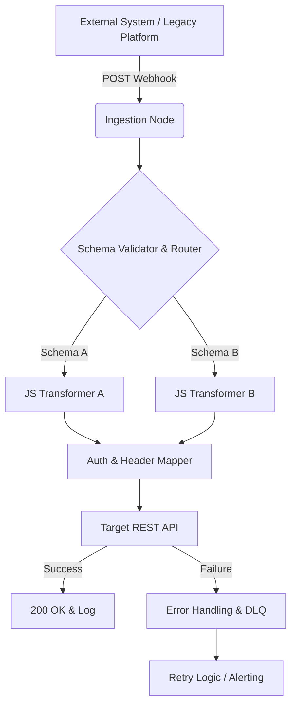

# Cloud Automation to Self-Hosted n8n Migration Kit: API Translation Workflows


> **Seamlessly migrate webhook pipelines and API integrations from expensive cloud platforms to self-hosted n8n.**

---

## ⚡ Instant Download & Turnkey Blueprint

- 📦 **Complete Production Package (€19 (Use code `EARLYBIRD` for -20%)):** 👉 **[Download on Gumroad](https://mannyverse767.gumroad.com/l/okdvtk)**
- 🎁 **Free Starter Blueprints (0€):**
  - [Autonomous AI Memory & Notion/Airtable RAG Sync (n8n Engine)](https://mannyverse767.gumroad.com/l/ai-agent-memory-rag-sync-notion-airtable-n8n-20260929)
  - [Programmatic SEO Markdown Engine with Quality Gates (Python)](https://mannyverse767.gumroad.com/l/programmatic-seo-markdown-generator-python-20260929)
- 💎 **MR Studio All-Access Lifetime Vault (€39 One-Time):** **[Unlock All Current + Future Workflows & Engines](https://mannyverse767.gumroad.com/l/depoud)**

---

## 🎯 The Problem & Financial ROI

Migrating complex webhooks, custom API requests, and data routing from expensive cloud-hosted automation platforms to a self-hosted environment is tedious and error-prone. Rebuilding hundreds of nodes manually drains developer hours and risks payload mismatch downtime.

| Metric | ❌ Traditional Cloud SaaS | ✅ MR Studio Self-Hosted Blueprint |
| :--- | :--- | :--- |
| **Annual Cost** | $600 – $2,400 / year | **€19 One-Time** |
| **Data Privacy & IP** | Third-party cloud lock-in | **100% Self-Hosted on your own infra** |
| **Execution Limits** | Strict per-task / per-seat quotas | **Unlimited runs & full source ownership** |
| **Stack** | Closed black-box | **n8n JSON Workflow** |

---

## 🛠️ Key Capabilities Included in the Package

- ✅ **Standardized webhook payload ingestion and translation routing**
- ✅ **Pre-built REST API authentication & header mapping utilities**
- ✅ **Drop-in JavaScript transformation nodes for structural alignment**
- ✅ **Automated execution testing and error-handling pipelines**


---

## 📖 Technical Documentation & Setup Guide

# Cloud Automation to Self-Hosted n8n Migration Kit: API Translation Workflows

[](https://n8n.io)
[]()
[](https://opensource.org/licenses/MIT)

## 1. Overview & Architecture

Migrating complex webhooks, custom API request chains, and data routing logic from managed, expensive cloud-hosted automation platforms (e.g., Zapier, Make, Workato) to a self-hosted n8n environment is historically tedious and highly error-prone. Rebuilding hundreds of execution nodes manually consumes extensive developer resources and introduces the risk of payload mismatch downtime during DNS cutovers.

This **Migration Kit** provides a deterministic, automated approach to system migration. Encapsulated within a single deployable asset (`workflow_n8n.json`), it acts as an intelligent translation layer that normalizes legacy payloads, authenticates outgoing requests, and handles execution routing natively in n8n.

### Core Features
*   **Standardized Webhook Payload Ingestion & Translation Routing:** Dynamically accepts incoming webhooks from legacy systems or external providers, evaluates the payload schema, and routes it to the appropriate downstream logic.
*   **Pre-built REST API Authentication & Header Mapping Utilities:** Configurable components to automatically inject Bearer tokens, OAuth2 flows, and custom headers required by your target infrastructure.
*   **Drop-in JavaScript Transformation Nodes:** Highly performant, pre-written Code nodes designed for deep structural alignment, JSON flattening, and schema transformations.
*   **Automated Execution Testing & Error-Handling Pipelines:** Integrated Dead Letter Queue (DLQ) logic that catches failed external API calls, logs the raw payload, and triggers alerting mechanisms (Slack/PagerDuty) while maintaining execution idempotency.

### Architecture Topology


---

## 2. Prerequisites & Environment Setup

To ensure deterministic execution and prevent node deprecation issues, your host environment must meet the following specifications:

*   **Runtime:** Node.js v18.x+ (if running n8n via npm, though Docker is strictly recommended).
*   **Engine:** Self-Hosted n8n version `>= 1.0.0`.
*   **Infrastructure:** Docker Engine `20.10+` and Docker Compose `v2.x`.
*   **Network:** A configured reverse proxy (NGINX/Traefik) handling SSL termination, as webhook ingestion requires valid HTTPS for most legacy outbound webhooks.
*   **Global Dependencies:** The built-in `vm2` sandbox must be enabled for the JavaScript transformation nodes to execute safely.

---

## 3. Installation & Quickstart

The entire translation architecture is packaged as a standard n8n JSON workflow. Follow these steps to deploy and activate the migration kit.

### Step 1: Import the Workflow
1. Access your self-hosted n8n instance via the web UI.
2. Navigate to **Workflows** -> **Add Workflow**.
3. In the top right menu (`...`), select **Import from File**.
4. Upload the provided `workflow_n8n.json` file.

### Step 2: Establish Credentials
The workflow utilizes n8n's credential management system to prevent hardcoding secrets.
1. Double-click the **Pre-built REST API Authentication** node.
2. Select **Create New Credential** (Choose *Header Auth*, *OAuth2*, or *Custom API* depending on your target endpoint).
3. Input your API keys and save. The credential ID will automatically bind to the node.

### Step 3: Configure Ingestion Webhook
1. Open the **Webhook Ingestion** node.
2. Copy the **Production URL**.
3. Update your legacy platform or external data provider to POST payloads to this new URL.

### Step 4: Activate and Test
1. Toggle the workflow to **Active** (top right corner).
2. Send a test payload from your external system.
3. Monitor the **Executions** tab to verify the payload passed through the JS Transformation and successfully hit the mock target API.

---

## 4. Configuration Options (.env explanation)

To ensure this workflow is fully portable across staging and production environments, the JS Transformation nodes and API nodes reference environment variables via n8n's `$env` expression syntax (e.g., `{{ $env["TARGET_API_URL"] }}`). 

You must define the following variables in your n8n host's `.env` file prior to starting the Docker container:

| Variable | Type | Description | Default |
| :--- | :--- | :--- | :--- |
| `MIGRATION_SOURCE_TOKEN` | `string` | Secret token expected in the headers of incoming legacy webhooks for validation. | `null` |
| `TARGET_API_URL` | `string` | The base URI for the new internal or external API where payloads are routed post-transformation. | `http://localhost:3000` |
| `MIGRATION_RETRY_LIMIT` | `integer` | Maximum number of retry attempts the Error-Handling pipeline will execute before routing to the DLQ. | `3` |
| `DLQ_ALERT_WEBHOOK` | `string` | Endpoint for PagerDuty or Slack to receive execution failure alerts. | `null` |
| `ENABLE_PAYLOAD_LOGGING` | `boolean` | If `true`, the workflow will write full JSON payloads to the console/stdout for debugging. Set to `false` in prod to save memory. | `false` |

**Example `.env` implementation:**
```bash
# n8n Docker configuration
N8N_ENFORCE_SETTINGS_FILE_PERMISSIONS=true
EXECUTIONS_DATA_SAVE_ON_ERROR=all
EXECUTIONS_DATA_SAVE_ON_SUCCESS=none

# Migration Kit Workflow Variables
MIGRATION_SOURCE_TOKEN=sk_live_123456789
TARGET_API_URL=https://api.internal-infra.com/v2
MIGRATION_RETRY_LIMIT=5
DLQ_ALERT_WEBHOOK=https://hooks.slack.com/services/T00000000/B00000000/XXXX
ENABLE_PAYLOAD_LOGGING=false
```

---

## 5. Production Tips & Maintenance

To maintain high availability and prevent performance degradation during high-volume migration cutovers, adhere to the following operational standards:

### Scaling Execution (Queue Mode)
If you are migrating high-throughput webhooks (e.g., >50 requests/second), standard n8n execution will bottleneck on the main process. You must deploy n8n in **Queue Mode**.
*   Deploy a Redis instance and configure `QUEUE_BULL_REDIS_HOST`.
*   Spin up minimum 2 n8n worker nodes to process the JS Transformation workloads asynchronously.

### Memory & Execution Pruning
Payload transformations (especially flattened large JSON arrays) consume significant V8 heap space. 
*   Ensure `EXECUTIONS_DATA_PRUNE=true` and `EXECUTIONS_DATA_MAX_AGE=168` (7 days) are set in your environment.
*   Configure the workflow settings to **Do not save successful executions**. Only save failed executions to preserve PostgreSQL database I/O.

### Modifying the JS Transformation Nodes
The drop-in Code nodes utilize standard ECMAScript 2022. When modifying structural alignment logic:
*   Always return an array of objects: `return [{ json: transformedData }];`.
*   Use `Object.keys()` and `reduce()` for dynamic key mapping rather than hardcoding legacy keys, which ensures resilience against upstream schema mutations.

---

## 6. License & Support Info

### License
This Migration Kit is distributed under the **MIT License**. You are free to use, modify, and distribute this architecture in both commercial and open-source capacities. See the `LICENSE` file for full text.

### Support & Contributions
*   **Issues:** For bug reports or feature requests regarding the `workflow_n8n.json` logic, please open an issue in the project repository. Include your n8n version and a sanitized sample payload.
*   **Contributions:** Pull requests adding additional pre-built legacy-to-modern schema maps (e.g., specific Zapier formatters to native JS equivalents) are highly encouraged. Please run the included automated execution testing pipelines locally before submitting a PR.
*   **Community:** For general n8n self-hosting questions, consult the [n8n Community Forum](https://community.n8n.io/).

---

## 🚀 Ready to Deploy in Under 5 Minutes?

Skip days of trial-and-error debugging. Grab the verified, production-tested package (including full source/JSON, `.env.example`, and automated test suite):

👉 **[Get Cloud Automation to Self-Hosted n8n Migration Kit: API Translation Workflows on Gumroad](https://mannyverse767.gumroad.com/l/okdvtk)** *(Promo code: `EARLYBIRD` for -20%)*
