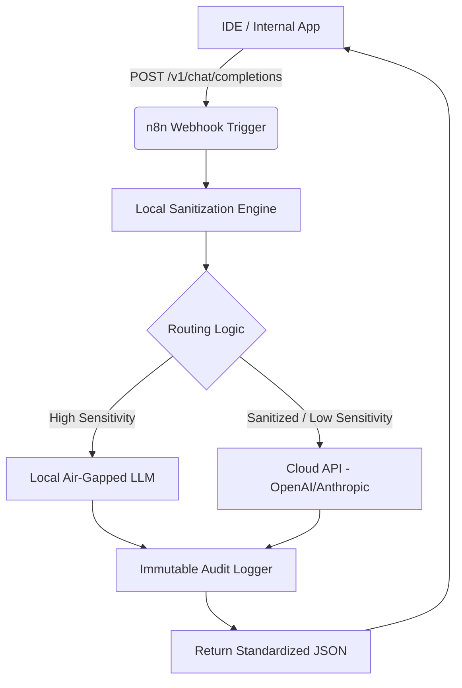

# Enterprise AI Prompt Sanitizer & Secure Routing Engine — n8n Workflow


> **Secure your proprietary source code with a self-hosted AI prompt sanitizer, local routing engine, and compliance proxy.**

---

## ⚡ Instant Download & Turnkey Blueprint

- 📦 **Complete Production Package (€19 (Use code `EARLYBIRD` for -20%)):** 👉 **[Download on Gumroad](https://mannyverse767.gumroad.com/l/zovtyg)** | ⚡ **[Instant Access on Whop](https://whop.com/mr-studio-7faa/enterprise-ai-prompt-sanitizer-secure-routing-engine-n8n-workflow)**
- 🎁 **Free Starter Blueprints (0€):**
  - [Autonomous AI Memory & Notion/Airtable RAG Sync (n8n Engine)](https://mannyverse767.gumroad.com/l/ai-agent-memory-rag-sync-notion-airtable-n8n-20260929)
  - [Programmatic SEO Markdown Engine with Quality Gates (Python)](https://mannyverse767.gumroad.com/l/programmatic-seo-markdown-generator-python-20260929)
- 💎 **MR Studio All-Access Lifetime Vault (€39 One-Time):** **[Unlock All Current + Future Workflows & Engines](https://mannyverse767.gumroad.com/l/depoud)**

---

## 🎯 The Problem & Financial ROI

Cloud-based AI coding assistants expose proprietary source code and sensitive credentials to third-party servers, leading to severe compliance violations. Engineering teams are forced to disable powerful AI tools to protect intellectual property. This workflow provides a secure, self-hosted proxy that automatically redacts sensitive data before it ever leaves your infrastructure.

| Metric | ❌ Traditional Cloud SaaS | ✅ MR Studio Self-Hosted Blueprint |
| :--- | :--- | :--- |
| **Annual Cost** | $600 – $2,400 / year | **€19 One-Time** |
| **Data Privacy & IP** | Third-party cloud lock-in | **100% Self-Hosted on your own infra** |
| **Execution Limits** | Strict per-task / per-seat quotas | **Unlimited runs & full source ownership** |
| **Stack** | Closed black-box | **n8n JSON Workflow** |

---

## 🛠️ Key Capabilities Included in the Package

- ✅ **Automated Credential & PII Redaction via Local Logic**
- ✅ **Dynamic Routing between Local Air-Gapped Models and Cloud APIs**
- ✅ **Immutable Audit Logging of all Inbound and Outbound Prompts**
- ✅ **Drop-in API Compatibility with Standard AI Endpoints**


---

## 📖 Technical Documentation & Setup Guide

# Enterprise AI Prompt Sanitizer & Secure Routing Engine

## 1. Overview & Architecture

Cloud-based AI coding assistants and LLM APIs inherently expose proprietary source code, sensitive credentials, and Personally Identifiable Information (PII) to third-party servers. This creates severe compliance violations (SOC2, HIPAA, GDPR) and forces engineering teams to disable powerful AI productivity tools to protect intellectual property.

This n8n workflow (`workflow_n8n.json`) acts as a secure, self-hosted proxy layer. It intercepts outbound LLM requests from your internal tools, automatically redacts sensitive data before it leaves your infrastructure, and intelligently routes prompts based on data classification.

### Core Features
*   **Automated Credential & PII Redaction via Local Logic:** Utilizes high-performance regex and local NLP nodes to strip API keys, passwords, emails, and proprietary markers before external transmission.
*   **Dynamic Routing between Local Air-Gapped Models and Cloud APIs:** Automatically routes highly sensitive or internal-only queries to local, air-gapped models (e.g., Ollama, vLLM) while allowing sanitized, general queries to pass to cloud providers (e.g., OpenAI, Anthropic).
*   **Immutable Audit Logging of all Inbound and Outbound Prompts:** Asynchronously writes all raw inputs, redaction diffs, and routing decisions to a secure database for compliance auditing and anomaly detection.
*   **Drop-in API Compatibility with Standard AI Endpoints:** Exposes a webhook structured to mimic the standard OpenAI API specification, allowing seamless integration with IDEs (Cursor, Copilot) and internal applications without client-side code changes.

### Architecture Flow


---

## 2. Prerequisites & Environment Setup

To deploy this workflow securely, your environment must meet the following requirements:

*   **n8n Instance:** Self-hosted n8n (v1.0.0 or higher). Cloud-hosted n8n is *not* recommended for this use case, as the primary goal is data sovereignty.
*   **Node.js / Docker:** Standard n8n Docker deployment environment.
*   **Local LLM Infrastructure (Optional but Recommended):** An accessible endpoint for local inference (e.g., Ollama, vLLM, or TGI) deployed within your VPC.
*   **Audit Database:** A PostgreSQL, Elasticsearch, or MongoDB instance for immutable audit logging.
*   **Network:** The n8n instance must be accessible by your internal clients (IDEs, apps) but should restrict outbound traffic strictly to approved Cloud LLM endpoints.

---

## 3. Installation & Quickstart

Follow these steps to deploy the workflow into your n8n instance.

### Step 1: Import the Workflow
1. Download the `workflow_n8n.json` file from this repository.
2. Access your n8n UI.
3. Navigate to **Workflows** -> **Add Workflow**.
4. Click the **Options** menu (three dots in the top right) -> **Import from File**.
5. Select `workflow_n8n.json`.

### Step 2: Configure Credentials
The workflow requires specific credentials to function. Navigate to **Credentials** in n8n and configure:
*   **Cloud LLM API Keys:** (e.g., OpenAI API, Anthropic API).
*   **Audit Database Credentials:** (e.g., PostgreSQL connection string).
*   **Webhook Authentication:** Set up Header Auth (e.g., `Authorization: Bearer <YOUR_INTERNAL_TOKEN>`) on the primary Webhook node to prevent unauthorized internal access.

### Step 3: Activate and Map the Endpoint
1. Toggle the workflow to **Active**.
2. Open the primary Webhook node and copy the **Production URL**. It should look like: `https://<your-n8n-domain>/webhook/v1/chat/completions`.

### Step 4: Test the Drop-in Replacement
Point your client application or IDE to the n8n webhook URL. 

```bash
curl -X POST https://<your-n8n-domain>/webhook/v1/chat/completions \
  -H "Content-Type: application/json" \
  -H "Authorization: Bearer <YOUR_INTERNAL_TOKEN>" \
  -d '{
    "model": "gpt-4",
    "messages": [
      {"role": "system", "content": "You are a coding assistant."},
      {"role": "user", "content": "Fix this code: DB_PASS=supersecret123; connect(DB_PASS);"}
    ]
  }'
```
*Observe the audit logs to verify that `supersecret123` was redacted to `[REDACTED_CREDENTIAL]` before routing.*

---

## 4. Configuration Options

Behavior is controlled via environment variables passed to the n8n Docker container, which are referenced inside the workflow using `{{ $env.VARIABLE_NAME }}`.

Add the following to your n8n `.env` file:

```ini
# Routing & Thresholds
ROUTING_SENSITIVITY_THRESHOLD=0.8       # Float (0.0-1.0). Confidence score to force routing to local models.
DEFAULT_CLOUD_MODEL=gpt-4o              # Fallback cloud model for sanitized prompts.
LOCAL_LLM_ENDPOINT=http://ollama:11434  # Internal URL for air-gapped inference.

# Sanitization Rulesets
REDACT_CREDENTIALS=true                 # Enable/disable regex-based credential stripping.
REDACT_PII=true                         # Enable/disable PII (Email, SSN, Phone) stripping.
CUSTOM_REGEX_PATTERNS="(?i)api_key.*"   # Comma-separated custom regex patterns for proprietary markers.

# Audit Logging
AUDIT_LOG_ENABLED=true
AUDIT_DB_HOST=postgres.internal
AUDIT_DB_TABLE=prompt_audit_logs

# Webhook Security
INTERNAL_API_TOKEN=sk-internal-proxy-123 # Token required by the n8n Webhook node.
```

---

## 5. Production Tips & Maintenance

To ensure enterprise-grade reliability and security, adhere to the following operational guidelines:

### High Availability & Scaling
*   **Queue Mode:** For high-throughput environments (e.g., hundreds of engineers using Copilot simultaneously), deploy n8n in **Queue Mode** using Redis and PostgreSQL. This offloads webhook execution to distributed worker nodes.
*   **Timeout Tuning:** LLM responses can be slow. Ensure your reverse proxy (Nginx/Traefik) and n8n `WEBHOOK_TIMEOUT` environment variables are configured to handle long-polling (recommendation: `120s` minimum).

### Security Posture
*   **Network Isolation:** Deploy the n8n proxy in a dedicated private subnet. Apply egress filtering to ensure n8n can *only* communicate with approved LLM providers (e.g., `api.openai.com`) and internal databases.
*   **TLS Termination:** Ensure the webhook endpoint is secured via TLS 1.2+ at the load balancer or reverse proxy level. Never expose the n8n raw HTTP port.

### Maintenance
*   **Regex Pattern Updates:** Threat vectors and credential formats evolve. Schedule a quarterly review of the `CUSTOM_REGEX_PATTERNS` to ensure new proprietary token formats are included.
*   **Audit Log Rotation:** Prompt logs grow rapidly. Implement a lifecycle policy on your audit database to archive logs older than 90 days to cold storage (e.g., AWS S3 via Glacier) to maintain query performance.

---

## 6. License & Support Info

**License:** 
This workflow and associated documentation are licensed under the **Apache License 2.0**. You are free to use, modify, and distribute this software within your organization, provided that proper attribution is maintained. 

**Support & Contributions:**
*   **Bug Reports:** Please open an issue in the repository issue tracker providing execution logs (scrubbed of PII) and n8n version details.
*   **Enterprise Support:** For SLA-backed support, custom sanitization logic development, or infrastructure auditing, contact your enterprise account representative. 
*   **Contributing:** Pull requests for improved regex patterns, additional local LLM integrations, or performance optimizations are highly encouraged. Please ensure all workflow JSON contributions pass the standard n8n linter.

---

## 🚀 Ready to Deploy in Under 5 Minutes?

Skip days of trial-and-error debugging. Grab the verified, production-tested package (including full source/JSON, `.env.example`, and automated test suite):

👉 **[Get Enterprise AI Prompt Sanitizer & Secure Routing Engine — n8n Workflow on Gumroad](https://mannyverse767.gumroad.com/l/zovtyg)** *(Promo code: `EARLYBIRD` for -20%)*
