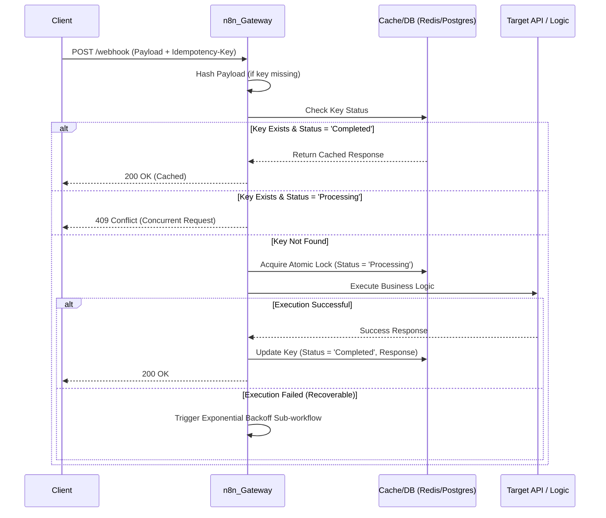

# Idempotency Gateway & Safe Retry Engine — n8n Workflow


> **Production-grade n8n pipeline that intercepts duplicate API executions to guarantee safe retries and protect client billing.**

---

## ⚡ Instant Download & Turnkey Blueprint

- 📦 **Complete Production Package (€17 (Use code `EARLYBIRD` for -20%)):** 👉 **[Download on Gumroad](https://mannyverse767.gumroad.com/l/ktiiij)**
- 🎁 **Free Starter Blueprints (0€):**
  - [Autonomous AI Memory & Notion/Airtable RAG Sync (n8n Engine)](https://mannyverse767.gumroad.com/l/ai-agent-memory-rag-sync-notion-airtable-n8n-20260929)
  - [Programmatic SEO Markdown Engine with Quality Gates (Python)](https://mannyverse767.gumroad.com/l/programmatic-seo-markdown-generator-python-20260929)
- 💎 **MR Studio All-Access Lifetime Vault (€39 One-Time):** **[Unlock All Current + Future Workflows & Engines](https://mannyverse767.gumroad.com/l/depoud)**

---

## 🎯 The Problem & Financial ROI

Failing automation runs often lead to blind retries from external systems. In payment or CRM workflows, this results in charging clients twice or creating duplicate records, destroying customer trust and creating massive operational overhead.

| Metric | ❌ Traditional Cloud SaaS | ✅ MR Studio Self-Hosted Blueprint |
| :--- | :--- | :--- |
| **Annual Cost** | $600 – $2,400 / year | **€17 One-Time** |
| **Data Privacy & IP** | Third-party cloud lock-in | **100% Self-Hosted on your own infra** |
| **Execution Limits** | Strict per-task / per-seat quotas | **Unlimited runs & full source ownership** |
| **Stack** | Closed black-box | **n8n JSON Workflow** |

---

## 🛠️ Key Capabilities Included in the Package

- ✅ **Idempotency Key validation to identify and block duplicate requests**
- ✅ **Atomic locking mechanisms to prevent millisecond race conditions**
- ✅ **Exponential backoff routing for safe, automated failure retries**
- ✅ **Native payload hashing without requiring external middleware**


---

## 📖 Technical Documentation & Setup Guide

# Idempotency Gateway & Safe Retry Engine — n8n Workflow

[](https://n8n.io/)
[](#)
[](https://opensource.org/licenses/MIT)

A mission-critical n8n workflow designed to intercept, validate, and process incoming webhook requests safely. This engine prevents duplicate processing caused by blind retries from external systems (e.g., Stripe, Shopify, CRMs), eliminating the risk of double-charging clients or duplicating database records. 

## 1. Overview & Architecture

Failing automation runs or network timeouts often trigger automated retries from upstream systems. Without an idempotency layer, these retries cause race conditions and duplicate executions. 

This workflow acts as a reverse proxy/gateway for your core business logic, guaranteeing **exactly-once execution** regardless of how many times a client retries a request.

### Core Features
* **Idempotency Key Validation**: Intercepts `Idempotency-Key` headers to identify and block duplicate requests instantly, returning the cached response of the original successful execution.
* **Atomic Locking Mechanisms**: Prevents millisecond race conditions (e.g., double-clicks) by utilizing transactional locks before workflow execution begins.
* **Native Payload Hashing**: Automatically falls back to generating a deterministic SHA-256 hash of the incoming request body if no idempotency key is provided—requiring zero external middleware.
* **Exponential Backoff Routing**: Intelligently routes failed internal requests to a safe retry loop with an exponential backoff algorithm, preventing rate-limit cascades.

### Architecture Flow



## 2. Prerequisites & Environment Setup

To deploy this workflow effectively in a production environment, ensure the following requirements are met:

* **n8n Instance**: v1.0.0 or higher.
* **Storage Backend**: A Redis instance (recommended) or PostgreSQL database for distributed atomic locking and high-speed key/value lookups.
* **Execution Mode**: `main` or `queue` mode (queue mode recommended for high-throughput environments).

## 3. Installation & Quickstart

### Step 1: Import the Workflow
1. Download the `workflow_n8n.json` file.
2. Open your n8n instance and navigate to **Workflows**.
3. Click **Add Workflow** -> **Import from File**.
4. Select `workflow_n8n.json`.

### Step 2: Configure the Storage Credentials
1. Open the **Credentials** tab in n8n.
2. Create a new credential for your chosen storage backend (e.g., Redis or PostgreSQL).
3. Open the newly imported workflow, locate the "Lock/Cache Storage" nodes, and assign your credentials.

### Step 3: Activate and Test
1. Toggle the workflow to **Active**.
2. Copy the Production Webhook URL.
3. Send a test payload using cURL:
   ```bash
   curl -X POST <YOUR_N8N_WEBHOOK_URL> \
     -H "Content-Type: application/json" \
     -H "Idempotency-Key: req_12345abcde" \
     -d '{"customer_id": "cus_999", "amount": 5000}'
   ```
4. Send the exact same request again. The workflow will intercept the second request and return the cached success response without re-triggering the downstream logic.

## 4. Configuration Options (.env explanation)

For robust deployments, parameterize the workflow using n8n environment variables. Add these to your n8n `.env` file and reference them inside the workflow via `{{ $env.VARIABLE_NAME }}`.

| Variable | Description | Default |
| :--- | :--- | :--- |
| `IDEMPOTENCY_TTL_HOURS` | Time-to-live for stored idempotency keys and cached responses. | `24` |
| `LOCK_TIMEOUT_MS` | Maximum duration an atomic lock is held before auto-release (prevents deadlocks if n8n crashes). | `30000` |
| `RETRY_MAX_ATTEMPTS` | Maximum number of exponential backoff retries for downstream failures. | `5` |
| `RETRY_BASE_DELAY_MS` | Base multiplier for exponential backoff calculations. | `1000` |
| `HASH_SECRET_SALT` | Secret salt used by the native Crypto node when hashing payloads to prevent collision attacks. | `[Required]` |

## 5. Production Tips & Maintenance

* **Concurrency Limits**: If using n8n without a message broker (RabbitMQ/Redis queue), ensure your `EXECUTIONS_PROCESS` setting in n8n is optimized to handle concurrent webhook bursts to prevent memory exhaustion before the idempotency layer can lock the requests.
* **Garbage Collection**: If utilizing PostgreSQL instead of Redis, configure a CRON-triggered n8n sub-workflow to prune idempotency records older than `IDEMPOTENCY_TTL_HOURS` to prevent database bloat.
* **Dead-Letter Queue (DLQ)**: If a request exhausts all exponential backoff retries, the workflow routes the payload to a "Failure Alert" node. Connect this node to Slack/PagerDuty and a DLQ database for manual operational review.
* **Header Normalization**: Downstream systems may send varying casing for headers (e.g., `idempotency-key` vs `Idempotency-Key`). The workflow's ingress node normalizes all headers to lowercase prior to evaluation.

## 6. License & Support Info

**License:** Distributed under the MIT License. See `LICENSE` for more information.

**Support:**
This is a technical infrastructure template. For issues related to n8n node execution, refer to the [official n8n documentation](https://docs.n8n.io/). 

For bugs related specifically to the locking mechanisms or backoff logic in this workflow template, please open an issue in the repository tracking this file. Provide execution logs (scrubbed of PII) and the exact n8n version you are running.

---

## 🚀 Ready to Deploy in Under 5 Minutes?

Skip days of trial-and-error debugging. Grab the verified, production-tested package (including full source/JSON, `.env.example`, and automated test suite):

👉 **[Get Idempotency Gateway & Safe Retry Engine — n8n Workflow on Gumroad](https://mannyverse767.gumroad.com/l/ktiiij)** *(Promo code: `EARLYBIRD` for -20%)*
