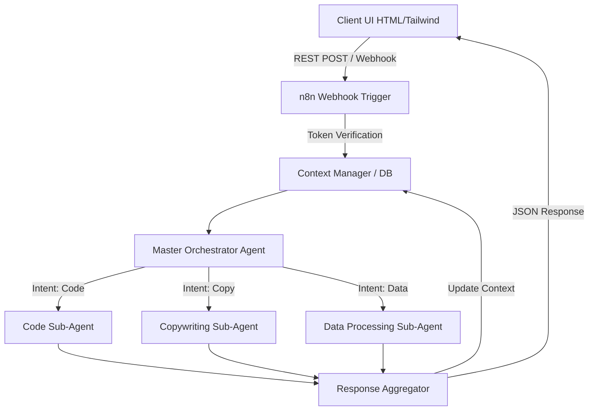

# n8n Micro-SaaS Agent Farm & Sub-Agent Orchestration Engine


> **Deploy a self-hosted, multi-agent Micro-SaaS backend in n8n with orchestrated sub-agents and ready-to-use frontend UI components.**

---

## ⚡ Instant Download & Turnkey Blueprint

- 📦 **Complete Production Package (€19 (Use code `EARLYBIRD` for -20%)):** 👉 **[Download on Gumroad](https://mannyverse767.gumroad.com/l/crixzs)** | ⚡ **[Instant Access on Whop](https://whop.com/mr-studio-7faa/n8n-micro-saas-agent-farm-sub-agent-orchestration-engine)**
- 🎁 **Free Starter Blueprints (0€):**
  - [Autonomous AI Memory & Notion/Airtable RAG Sync (n8n Engine)](https://mannyverse767.gumroad.com/l/ai-agent-memory-rag-sync-notion-airtable-n8n-20260929)
  - [Programmatic SEO Markdown Engine with Quality Gates (Python)](https://mannyverse767.gumroad.com/l/programmatic-seo-markdown-generator-python-20260929)
- 💎 **MR Studio All-Access Lifetime Vault (€39 One-Time):** **[Unlock All Current + Future Workflows & Engines](https://mannyverse767.gumroad.com/l/depoud)**

---

## 🎯 The Problem & Financial ROI

Building scalable, multi-agent AI systems typically requires complex coding, expensive cloud orchestration subscriptions, and custom frontend development. Managing prompt logic, context limits, and sub-agent handoffs across proprietary enterprise platforms creates massive technical debt and recurring costs.

| Metric | ❌ Traditional Cloud SaaS | ✅ MR Studio Self-Hosted Blueprint |
| :--- | :--- | :--- |
| **Annual Cost** | $600 – $2,400 / year | **€19 One-Time** |
| **Data Privacy & IP** | Third-party cloud lock-in | **100% Self-Hosted on your own infra** |
| **Execution Limits** | Strict per-task / per-seat quotas | **Unlimited runs & full source ownership** |
| **Stack** | Closed black-box | **n8n JSON Workflow** |

---

## 🛠️ Key Capabilities Included in the Package

- ✅ **Master/Worker Sub-Agent Architecture for parallel processing**
- ✅ **Webhook-driven REST API endpoints for seamless frontend integration**
- ✅ **Reusable UI Component Library (HTML/Tailwind) for instant Micro-SaaS deployment**
- ✅ **Self-hosted memory and context management for zero-leak data operations**


---

## 📖 Technical Documentation & Setup Guide

# n8n Micro-SaaS Agent Farm & Sub-Agent Orchestration Engine

[](https://n8n.io)
[](./workflow_n8n.json)
[](#)

## 1. Overview & Architecture

Building scalable, multi-agent AI systems typically requires complex coding, expensive cloud orchestration subscriptions, and custom frontend development. Managing prompt logic, context limits, and sub-agent handoffs across proprietary enterprise platforms creates massive technical debt and recurring costs.

This project delivers a complete, self-hosted **n8n Micro-SaaS Agent Farm & Sub-Agent Orchestration Engine** via a single deployable workflow (`workflow_n8n.json`). It provides an infrastructure-as-code approach to deploying a scalable, multi-agent backend paired with a drop-in frontend component.

### Core Features
*   **Master/Worker Sub-Agent Architecture:** A routing master agent evaluates intent and dynamically delegates tasks to specialized worker sub-agents for parallel processing and deterministic output generation.
*   **Webhook-driven REST API:** Exposes secure, authenticated endpoints for seamless frontend integration, decoupling the AI logic from the client layer.
*   **Reusable UI Component Library:** Includes raw HTML/Tailwind assets for instant Micro-SaaS frontend deployment.
*   **Self-Hosted Memory & Context Management:** Implements isolated, database-backed chat memory to guarantee zero-leak data operations and strict tenant data segregation.

### Architectural Diagram



---

## 2. Prerequisites & Environment Setup

To run this orchestration engine, your infrastructure must meet the following requirements:

### System Requirements
*   **n8n instance:** Version `1.15.0` or higher (required for Advanced AI node compatibility). Self-hosted via Docker is strictly recommended for zero-leak data compliance.
*   **Vector/Relational Database:** PostgreSQL or Redis for persistent, stateful memory management across worker executions.
*   **LLM Provider Account:** OpenAI, Anthropic, or local LLM (Ollama/vLLM) credentials.

### Required n8n Nodes (Included in JSON)
*   `@n8n/n8n-nodes-langchain.agent`
*   `@n8n/n8n-nodes-langchain.toolWorkflow`
*   `n8n-nodes-base.webhook`
*   `@n8n/n8n-nodes-langchain.memoryPostgres` (or similar DB memory node)

---

## 3. Installation & Quickstart

Follow these steps to deploy the orchestration engine and connect the frontend.

### Step 1: Import the Workflow
1. Access your n8n workspace.
2. Navigate to **Workflows** -> **Add Workflow**.
3. Select **Import from File** and upload `workflow_n8n.json`, or open the JSON file, copy its contents, and paste directly into the n8n canvas.
4. Save the workflow.

### Step 2: Configure Credentials
The workflow canvas will highlight nodes requiring authentication. You must configure:
1.  **LLM Provider API Keys:** Attach your provider credentials to the Model nodes connected to the Master and Worker agents.
2.  **Memory Database:** Connect the PostgreSQL/Redis memory nodes to your local database instance for context retention.

### Step 3: Secure the Webhook
1. Open the primary **Webhook** node.
2. Under **Authentication**, select `Header Auth`.
3. Create a credential securely storing your expected `Authorization: Bearer <TOKEN>` to prevent unauthorized access to your Agent Farm.

### Step 4: Deploy the Frontend
1. Locate the `/ui` directory (containing the HTML/Tailwind components).
2. Open `index.html` and locate the API configuration block:
   ```javascript
   const N8N_WEBHOOK_URL = "https://your-n8n-instance.com/webhook/agent-farm";
   const API_BEARER_TOKEN = "your_secure_token";
   ```
3. Update the variables with your production n8n webhook URL and header auth token.
4. Serve the HTML directory via Nginx, Vercel, or any standard web server.

---

## 4. Configuration Options

Your n8n Docker environment should be configured to support high-throughput agent operations. Define the following in your instance's `.env` file.

```env
# Basic n8n Configuration
N8N_HOST=n8n.yourdomain.com
N8N_PORT=5678
N8N_PROTOCOL=https
NODE_ENV=production

# Webhook Authorization (Used in frontend UI)
MICROSAAS_API_TOKEN=sk-microsaas-xxx-12345

# Database Configuration (For Zero-Leak Memory Management)
DB_TYPE=postgresdb
DB_POSTGRESDB_DATABASE=n8n_memory
DB_POSTGRESDB_HOST=postgres
DB_POSTGRESDB_PORT=5432
DB_POSTGRESDB_USER=n8n_user
DB_POSTGRESDB_PASSWORD=strong_db_password

# Execution Scaling (Critical for Agent Farm)
EXECUTIONS_MODE=queue
QUEUE_BULL_REDIS_HOST=redis
QUEUE_BULL_REDIS_PORT=6379

# LLM Timeouts (Agents may take longer than standard HTTP requests)
N8N_HTTP_TIMEOUT=120000 
```

---

## 5. Production Tips & Maintenance

To ensure stability, low latency, and cost-efficiency in a production environment, adhere to the following operational guidelines:

### Horizontal Scaling (Queue Mode)
A multi-agent workflow is computationally expensive. Do not run this on n8n's default `regular` execution mode in production. Configure n8n for **Queue Mode** using Redis to distribute worker agent executions across multiple n8n worker instances. 

### Context Limit Management
Agent loops can rapidly consume token windows. 
*   **Windowed Memory:** Ensure the memory nodes attached to your Master Agent are configured to use a sliding window (e.g., retain only the last 10 interactions).
*   **Summarization Handoffs:** If passing massive datasets between Worker Agents, use an intermediate summarization node before passing the payload back to the Master Orchestrator.

### Zero-Leak Data Operations
Because this engine operates locally, you control the data plane. Ensure your LLM provider agreements stipulate zero-data-retention (e.g., OpenAI API Enterprise tier), or route the model nodes to locally hosted models (like Llama-3 via Ollama) to guarantee absolute data privacy for your Micro-SaaS tenants.

### Monitoring Sub-Agent Failures
Implement a generic error trigger (`Error Trigger Node`) in a separate workflow to catch and log sub-agent hallucination loops or tool-use failures. Configure this to push alerts to a dedicated Slack/Discord channel.

---

## 6. License & Support Info

**License:** MIT License. See `LICENSE` file for details. 
You are free to use, modify, and distribute this orchestration engine for commercial Micro-SaaS applications without attribution.

**Support:**
*   For issues specifically related to the n8n nodes or core functionality, refer to the [n8n official documentation](https://docs.n8n.io/).
*   For bugs within the sub-agent prompt logic or the frontend UI component, please open an issue in this repository.

*Note: This repository does not provide support for underlying infrastructure setup (Docker, Kubernetes, PostgreSQL configuration).*

---

## 🚀 Ready to Deploy in Under 5 Minutes?

Skip days of trial-and-error debugging. Grab the verified, production-tested package (including full source/JSON, `.env.example`, and automated test suite):

👉 **[Get n8n Micro-SaaS Agent Farm & Sub-Agent Orchestration Engine on Gumroad](https://mannyverse767.gumroad.com/l/crixzs)** *(Promo code: `EARLYBIRD` for -20%)*
