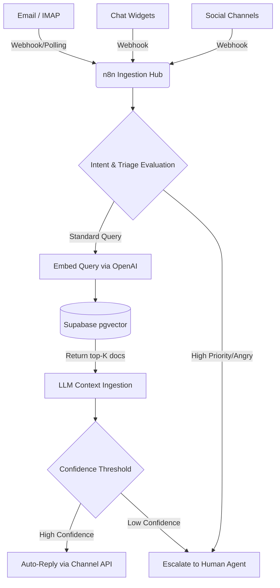

# Omnichannel AI Support Helpdesk — Supabase RAG Pipeline


> **A self-hosted, multi-channel AI helpdesk powered by Supabase RAG to automate customer support routing and resolution.**

---

## ⚡ Instant Download & Turnkey Blueprint

- 📦 **Complete Production Package (€19 (Use code `EARLYBIRD` for -20%)):** 👉 **[Download on Gumroad](https://mannyverse767.gumroad.com/l/rdamn)**
- 🎁 **Free Starter Blueprints (0€):**
  - [Autonomous AI Memory & Notion/Airtable RAG Sync (n8n Engine)](https://mannyverse767.gumroad.com/l/ai-agent-memory-rag-sync-notion-airtable-n8n-20260929)
  - [Programmatic SEO Markdown Engine with Quality Gates (Python)](https://mannyverse767.gumroad.com/l/programmatic-seo-markdown-generator-python-20260929)
- 💎 **MR Studio All-Access Lifetime Vault (€39 One-Time):** **[Unlock All Current + Future Workflows & Engines](https://mannyverse767.gumroad.com/l/depoud)**

---

## 🎯 The Problem & Financial ROI

Support teams are overwhelmed by repetitive inquiries scattered across emails, chat widgets, and social channels. Premium helpdesk platforms lock you into expensive per-seat pricing models, making it financially punishing to scale your customer service operations.

| Metric | ❌ Traditional Cloud SaaS | ✅ MR Studio Self-Hosted Blueprint |
| :--- | :--- | :--- |
| **Annual Cost** | $600 – $2,400 / year | **€19 One-Time** |
| **Data Privacy & IP** | Third-party cloud lock-in | **100% Self-Hosted on your own infra** |
| **Execution Limits** | Strict per-task / per-seat quotas | **Unlimited runs & full source ownership** |
| **Stack** | Closed black-box | **n8n JSON Workflow** |

---

## 🛠️ Key Capabilities Included in the Package

- ✅ **Multi-channel ingestion architecture for routing incoming queries to a central processing hub**
- ✅ **Native Supabase Vector integration for Semantic Search (RAG) against your company documentation**
- ✅ **Automated AI draft generation utilizing context-aware prompt engineering**
- ✅ **Human-in-the-loop fallback routing for complex, high-priority ticket escalation**


---

## 📖 Technical Documentation & Setup Guide

# Omnichannel AI Support Helpdesk — Supabase RAG Pipeline

A highly scalable, infrastructure-as-code helpdesk automation pipeline built for n8n. 

Support teams are consistently overwhelmed by repetitive inquiries scattered across emails, chat widgets, and social channels. Traditional premium helpdesk platforms solve this by locking organizations into expensive, per-seat pricing models—financially punishing you as your customer service operations scale. 

This repository provides a centralized, seat-free n8n workflow (`workflow_n8n.json`) that ingests omnichannel queries, leverages Supabase `pgvector` for Retrieval-Augmented Generation (RAG), drafts context-aware responses, and routes complex issues to human agents.

---

## 1. Overview & Architecture

This pipeline operates as a centralized event-driven processing hub. Incoming messages trigger the workflow, which retrieves relevant semantic context from your company documentation and uses an LLM to generate an actionable response or escalate the ticket.

### Core Features
* **Multi-channel ingestion architecture:** Normalizes inbound webhooks from Email (IMAP), Slack, Discord, and custom chat widgets into a standard JSON payload for centralized routing.
* **Native Supabase Vector integration:** Utilizes PostgreSQL `pgvector` for high-performance Semantic Search (RAG) against your indexed company documentation and historical tickets.
* **Automated AI draft generation:** Applies context-aware prompt engineering to synthesize the vector search results into accurate, customer-ready responses.
* **Human-in-the-loop fallback routing:** Programmatically evaluates confidence scores and user intent to escalate complex, high-priority, or high-friction tickets to human agents via your designated alerting channel.

### Architecture Flow


---

## 2. Prerequisites & Environment Setup

Ensure your infrastructure meets the following requirements before deployment:

* **n8n Instance:** Version `>= 1.0.0` (Self-hosted or n8n Cloud).
* **Supabase Project:** A dedicated Supabase instance with PostgreSQL and the `pgvector` extension enabled.
* **LLM Provider Account:** OpenAI API key (or equivalent supported by n8n's Advanced AI nodes) for generating embeddings (`text-embedding-3-small` or `ada-002`) and completions (`gpt-4o` or `gpt-3.5-turbo`).
* **Channel Access:** API keys, Webhook URLs, or IMAP credentials for your specific ingestion channels.

---

## 3. Installation & Quickstart

### Step 3.1: Initialize Supabase Database
You must prepare your Supabase PostgreSQL database to store embeddings and perform similarity searches. Execute the following SQL in your Supabase SQL Editor:

```sql
-- Enable the pgvector extension
create extension if not exists vector;

-- Create a table to store your knowledge base documents
create table if not exists knowledge_base (
  id bigserial primary key,
  content text,
  metadata jsonb,
  embedding vector(1536) -- Match the dimensions of your embedding model
);

-- Create a function for similarity search
create or replace function match_documents (
  query_embedding vector(1536),
  match_threshold float,
  match_count int
)
returns table (
  id bigint,
  content text,
  metadata jsonb,
  similarity float
)
language sql stable
as $$
  select
    knowledge_base.id,
    knowledge_base.content,
    knowledge_base.metadata,
    1 - (knowledge_base.embedding <=> query_embedding) as similarity
  from knowledge_base
  where 1 - (knowledge_base.embedding <=> query_embedding) > match_threshold
  order by similarity desc
  limit match_count;
$$;
```

### Step 3.2: Import the Workflow
1. Navigate to your n8n instance.
2. Click **Add Workflow** -> **Import from File**.
3. Select the provided `workflow_n8n.json` file.
4. The workflow graph will populate in the editor.

### Step 3.3: Configure Credentials
You will see warning icons (⚠️) on several nodes. Resolve these by configuring your credentials:
1. **Supabase Vector Store Node:** Add your Supabase Host URL and Service Role Key (do not use the anon key, as n8n requires read/write access).
2. **OpenAI Nodes (Embeddings & Chat Model):** Add your OpenAI API key.
3. **Ingestion Triggers:** Configure your specific IMAP settings, Slack Bot Tokens, or Webhook authentication headers depending on which channels you are actively using.

### Step 3.4: Activate and Test
1. Click **Save** in the top right corner.
2. Toggle the workflow to **Active**.
3. Send a test inquiry through one of your connected channels to verify end-to-end execution. Inspect the n8n execution logs to ensure RAG retrieval and LLM drafting are functioning correctly.

---

## 4. Configuration Options (.env explanation)

If you are self-hosting n8n via Docker, pass the following environment variables to securely manage your pipeline configuration without hardcoding variables into the workflow JSON. Use n8n's `$env()` expression inside the workflow to reference these.

```bash
# ==========================================
# n8n ENVIRONMENT VARIABLES (.env)
# ==========================================

# Supabase Credentials
SUPABASE_URL=https://<your-project-ref>.supabase.co
SUPABASE_SERVICE_KEY=eyJhbGciOiJIUzI1NiIsInR5c... # Use Service Role Key

# LLM Provider Configuration
OPENAI_API_KEY=sk-proj-...
# Optional: Fallback model configuration
LLM_COMPLETION_MODEL=gpt-4o
LLM_EMBEDDING_MODEL=text-embedding-3-small

# Helpdesk Thresholds (Referenced in n8n Switch/If nodes)
RAG_SIMILARITY_THRESHOLD=0.78       # Minimum cosine similarity to use a document
CONFIDENCE_THRESHOLD=0.85           # Minimum LLM confidence score to auto-reply

# Routing Configuration
HUMAN_ESCALATION_EMAIL=support-tier2@yourcompany.com
SLACK_ESCALATION_CHANNEL_ID=C01XXXXXX
```

---

## 5. Production Tips & Maintenance

To ensure high availability and accuracy in a production environment, implement the following practices:

* **Error Handling & Retry Logic:** The workflow is configured with an Error Trigger fallback. Ensure you connect this to an alerting system (e.g., PagerDuty, Slack) so infrastructure failures do not result in silently dropped customer tickets.
* **Vector Database Maintenance:** Periodically vacuum your PostgreSQL database and re-index vectors if your knowledge base grows beyond 100,000 documents to maintain sub-100ms semantic search latency.
  ```sql
  -- Optional: Create an index for faster vector queries on large datasets
  CREATE INDEX ON knowledge_base USING hnsw (embedding vector_cosine_ops);
  ```
* **Prompt Versioning:** The system prompt inside the Advanced AI node dictates the tone and strictness of the AI agent. Treat this prompt as code. Version control any changes to the prompt to prevent regressions in customer interactions.
* **Rate Limiting:** If ingesting from high-volume channels (like public Discord servers), configure n8n webhook rate limiting or utilize a message queue (e.g., RabbitMQ/Redis) before the webhook trigger to prevent memory exhaustion on your n8n container.

---

## 6. License & Support Info

**License:** Distributed under the MIT License. You are free to modify, distribute, and use this pipeline in commercial, closed-source support operations without restrictions.

**Support:**
* For issues specifically related to the `workflow_n8n.json` file (routing logic, node configuration), please open an issue in this repository.
* For core n8n execution environments, refer to the [n8n Community Forum](https://community.n8n.io/).
* For Supabase vector configuration troubleshooting, refer to the [pgvector documentation](https://github.com/pgvector/pgvector).

---

## 🚀 Ready to Deploy in Under 5 Minutes?

Skip days of trial-and-error debugging. Grab the verified, production-tested package (including full source/JSON, `.env.example`, and automated test suite):

👉 **[Get Omnichannel AI Support Helpdesk — Supabase RAG Pipeline on Gumroad](https://mannyverse767.gumroad.com/l/rdamn)** *(Promo code: `EARLYBIRD` for -20%)*
